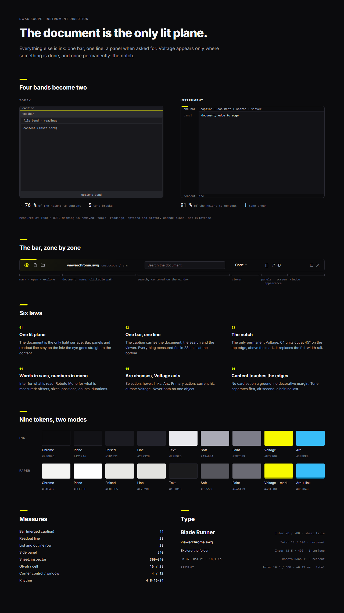
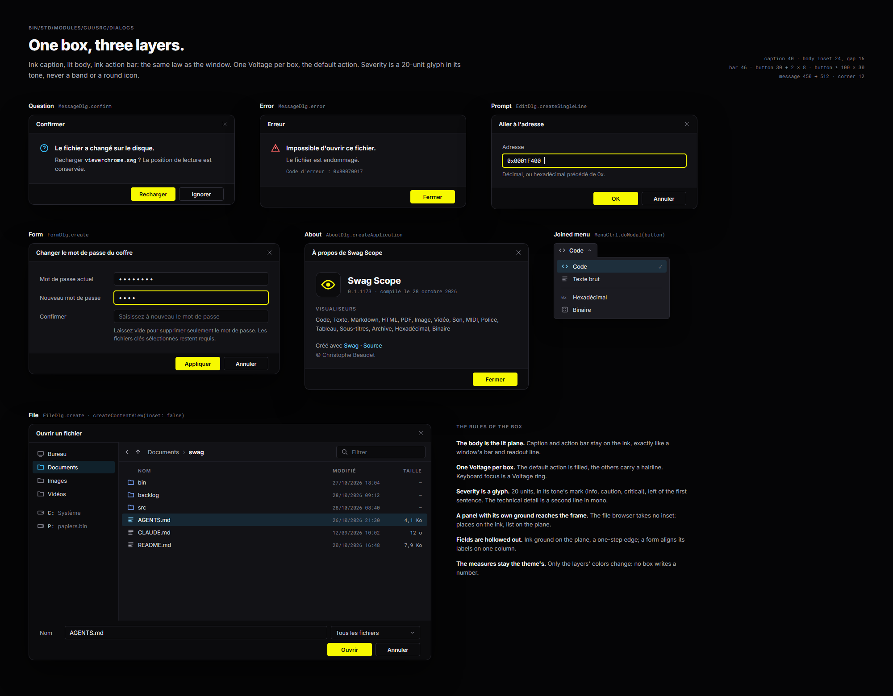
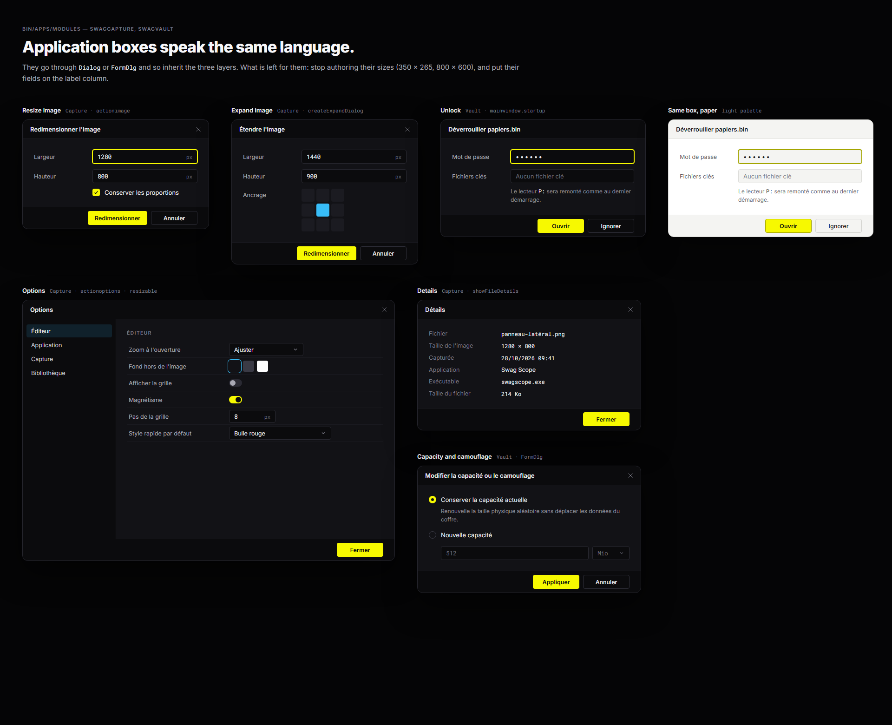
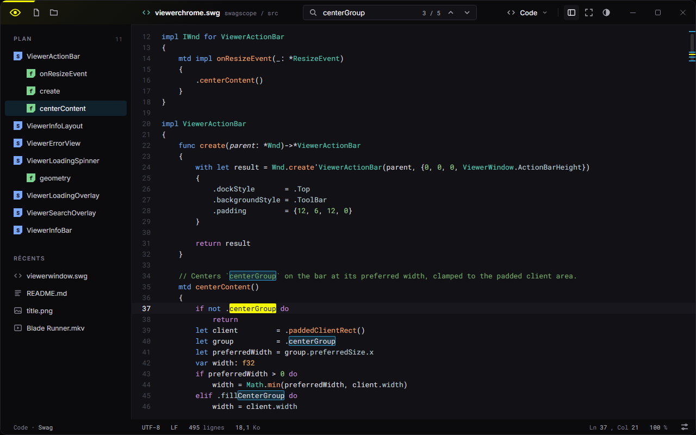
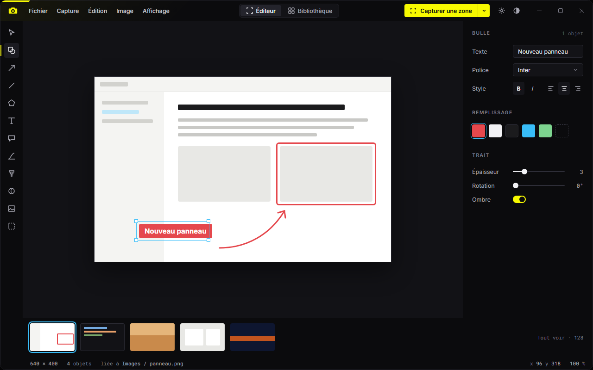
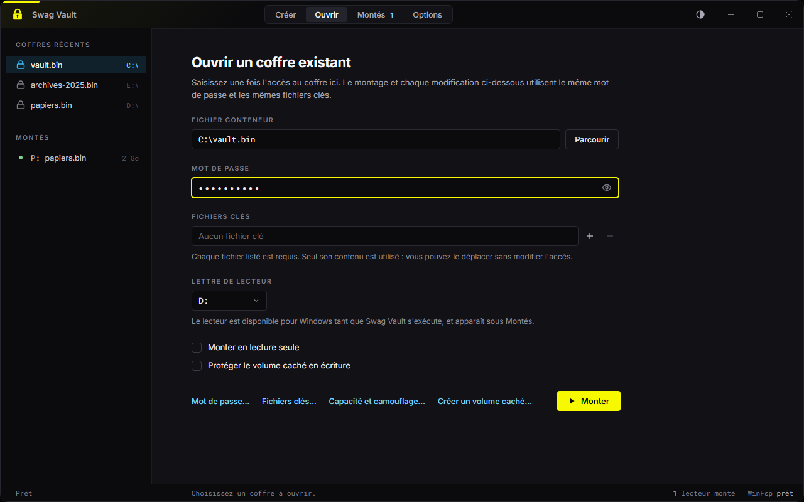

# Instrument — the design direction for Swag applications

This folder holds a proposed redesign of the four standard applications (Swag Scope, Swag Capture,
Swag Prism, Swag Vault) and of every modal box under `bin/`, both the shared ones in
`bin/std/modules/gui/src/dialogs` and the ones an application builds itself.

- [design.instrument.md](design.instrument.md) — the migration, as backlog entries.
- [imgs/](imgs/) — renders of every mockup. They are the target, not the current state.
- [mockups/](mockups/) — the HTML source of each render; open one in a browser.

The direction is not yet the charter. Until design.instrument.001 lands, the skills under
`.agents/skills/` still govern, and this page says where it departs from them.



## The idea

**The document is the only lit plane.** Everything that is not content — the bar, the panels, the
readout line, a dialog's caption and action bar — sits on the ink. The content is one step lighter
and reaches the window edges. That one contrast is what makes a Swag window recognizable before a
word of it is read.

The identity constants do not move: Voltage `#F7F900`, Arc `#38BDF8`, Ink `#0B0B0D`, the 45° cut,
the four-unit interface corner and the twelve-unit window corner, Inter for prose and Roboto Mono
for everything the compiler or a measurement names.

## Six laws

1. **One lit plane.** The document, canvas, form or list being worked on is the plane. Bars,
   panels, sheets and the readout line are chrome, on the ink.
2. **One bar, one line.** The caption carries the document's identity, the search, the viewer or
   mode switch and the trailing tools. Every reading of the document — encoding, counts, position,
   zoom, size — sits in one 28-unit readout line at the bottom. Nothing is removed: tools,
   readings, options and history change place, not existence.
3. **The notch.** The only permanent Voltage of a window: 64 × 3 units on the top edge above the
   mark, its trailing end cut at 45°. It replaces the full-width four-unit rail.
4. **Words in sans, numbers in mono.** Inter for what is read, Roboto Mono for what is measured:
   offsets, sizes, positions, counts, durations, paths.
5. **Arc chooses, Voltage acts.** Selection, hover and links take Arc. The primary action, the
   current search hit, the cursor and keyboard focus take Voltage. Never both on one object.
6. **Content touches the edges.** No card set on a ground, no decorative margin. Tone separates
   first, air second, a hairline last.

## Before and after

| | Today | Instrument |
| --- | --- | --- |
| Chrome bands above the content | caption, rail, toolbar, information bar | the caption alone |
| Below the content | an options band | the readout line |
| Content height at 1280 × 800 | about 76 % | 91 % |
| Tone breaks across the window | five | one |
| Permanent Voltage | a full-width four-unit rail | the 64-unit notch |

Current state: Scope [surface](../../bin/apps/modules/swagscope/src/tests/goldens/surface.png),
[viewer](../../bin/apps/modules/swagscope/src/tests/goldens/viewer.dark.png) and
[explorer](../../bin/apps/modules/swagscope/src/tests/goldens/explorer.gallery.png);
Capture [editor](../../bin/apps/modules/swagcapture/src/tests/goldens/surface.png) and
[library](../../bin/apps/modules/swagcapture/src/tests/goldens/library.surface.png);
Prism [comparison](../../bin/apps/modules/swagprism/src/tests/goldens/surface.comparison.png);
Vault [open](../../bin/apps/modules/swagvault/src/tests/goldens/surface.open.png).

## Tokens

Nine tokens per mode. The tones keep their block in both modes; on paper only their mark deepens.

| Token | Ink | Paper | Use |
| --- | --- | --- | --- |
| Chrome | `#0B0B0D` | `#F4F4F2` | Caption, panels, sheets, readout line, dialog caption and action bar |
| Plane | `#121216` | `#FFFFFF` | The document; a dialog body |
| Raised | `#1B1B21` | `#E8E8E5` | Hover, popups, a pressed tool |
| Line | `#23232B` | `#E2E2DF` | The one hairline between chrome and plane; control edges |
| Text | `#E9E9ED` | `#1B1B1D` | Body |
| Soft | `#A9A9B4` | `#55555C` | Secondary prose, values in the readout line |
| Faint | `#7D7D89` | `#6A6A73` | Labels, counts, units |
| Voltage | `#F7F900` | `#F7F900`, mark `#A3A500` | Primary action, focus, current hit, notch |
| Arc | `#38BDF8` | `#38BDF8`, link `#0570A0` | Selection, hover, links, alternate actions |

A field is hollowed out of the plane: chrome ground, line edge. Focus adds a Voltage ring.

## Measures

| Part | Logical units |
| --- | --- |
| Caption bar | 44 |
| Readout line | 28 |
| List, outline and panel row | 28 |
| Side panel | 240 |
| Sheet, inspector | 300–340 |
| Glyph in its cell | 16 in 28 (bar), 20 in 36 (tool rail) |
| Corner: control / window / popup joined to its trigger | 4 / 12 / 6 |
| Rhythm | 4 · 8 · 16 · 24 · 32 |

Type: document name Inter 13/600; interface Inter 12.5/400; sheet title Inter 20/700; readout
Roboto Mono 11; section label Inter 10.5/600, uppercase, +0.12 em.

## The caption bar

Leading group: the mark with the notch above it, then the application's openers (open, explore)
or its menu bar. Then the document's identity — a kind glyph, its name, its location in mono.
Centered group, centered on the window: the search field, a mode switch, or a primary command.
Trailing group: the viewer selector, panel toggles, full screen, then the Appearance button the
toolkit already places, then the window buttons. The caption keeps a faint wash from the mark
(`captionGlow`) and stays draggable wherever no control sits.

## Panels

A panel is chrome. Its sections open with an uppercase label; its rows are 28 units and select
with an Arc ground, never with a rail. An outline row may carry a 16-unit kind chip, the one
repeated element allowed the 45° cut, in the documentation's kind colors. A vertical tool rail
keeps its leading Voltage rule because it holds a persistent mode.

## Dialogs



A box has the same three layers as a window: the caption on chrome, the body on the plane, the
action bar on chrome. The dialog metrics do not change — inset 24, gap 16, bar 46 = button 30 +
2 × 8, button at least 100 × 30, a message from 450 to 512 wide — only the layers' colors do.

- One Voltage per box: the default action is filled; every other action carries a hairline.
- Severity is a 20-unit glyph in its tone's mark, left of the first sentence. The technical
  detail is a second line in mono. No band, no round icon.
- A body that is one panel with its own grounds reaches the frame: the file dialog puts its places
  on chrome and its list on the plane, with no inset.
- A form aligns its labels on one column; an option carries its own wording under the field it
  qualifies.
- About shows the application tile, the name, the version and build date in mono, its sections,
  then the links.



Application boxes go through `Dialog` or `FormDlg` and inherit the layers. What remains for them is
to stop authoring their sizes and to use the label column.

## Applications

### Swag Scope




### Swag Capture




### Swag Prism


### Swag Vault



## Where this departs from the current skills

- `build-swag-standard-apps` asks for exactly one four-unit accent rail across the top edge; the
  notch replaces it.
- The same skill lets an application add toolbar and information bands; here they fold into the
  caption and the readout line, and the content loses its inset card.
- `design-swag-themes` lets each bar keep its own ground; here they share the chrome token.
- `design-swag-dialogs` says nothing about layer colors and still allows a round icon in a box;
  here the box has three layers and a severity glyph.

## Open decisions

- Whether the neutral dark and light palettes take the chrome/plane split or keep following the
  desktop (design.instrument.002).
- Swag Vault's default window size (design.instrument.012).
- The name and owner of the readout control in `bin/std` (design.instrument.005).

## About the mockups

The pages under [mockups/](mockups/) are static HTML. [support.js](mockups/support.js) expands the
few `{{…}}` holes and `<sc-for>` repetitions two of them use. They load Inter and Roboto Mono from
Google Fonts; offline, the browser falls back to its own fonts. The application surfaces are drawn
in the French locale the applications ship, which is the longest one and therefore the one a
layout has to survive; the design prose around them is English. The source code, README text and
PNG bytes shown come from this repository. Posters, captures, file sizes, timings and the
assembly in the Prism mockup are illustrative.

To regenerate a render, from the repository root:

```powershell
& "C:\Program Files\Google\Chrome\Application\chrome.exe" --headless=new --hide-scrollbars `
    --force-device-scale-factor=1 --window-size=1280,800 --virtual-time-budget=5000 `
    --screenshot=backlog/design/imgs/scope.code.png "file:///$PWD/backlog/design/mockups/scope.code.html"
```

The system page renders at 1280 × 2280, the common dialogs at 2000 × 1560, the application dialogs
at 1920 × 1560, and every window at 1280 × 800.

Delete this folder when [design.instrument.md](design.instrument.md) has no entry left: by then
the rules live in the skills and the goldens show the result.
