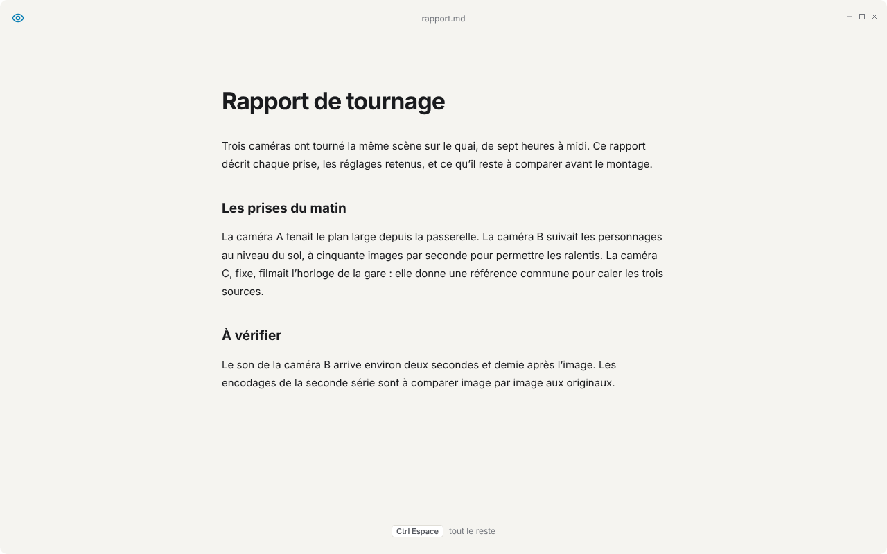
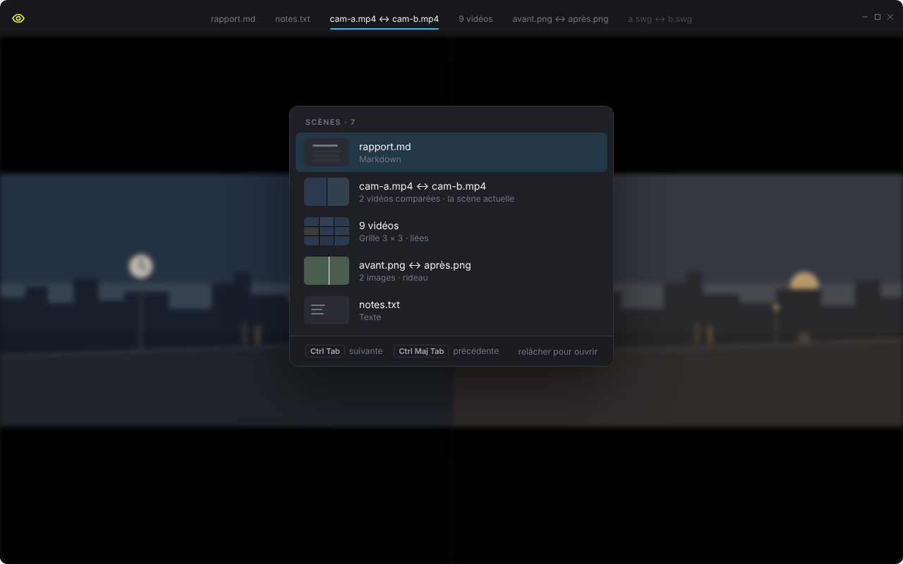
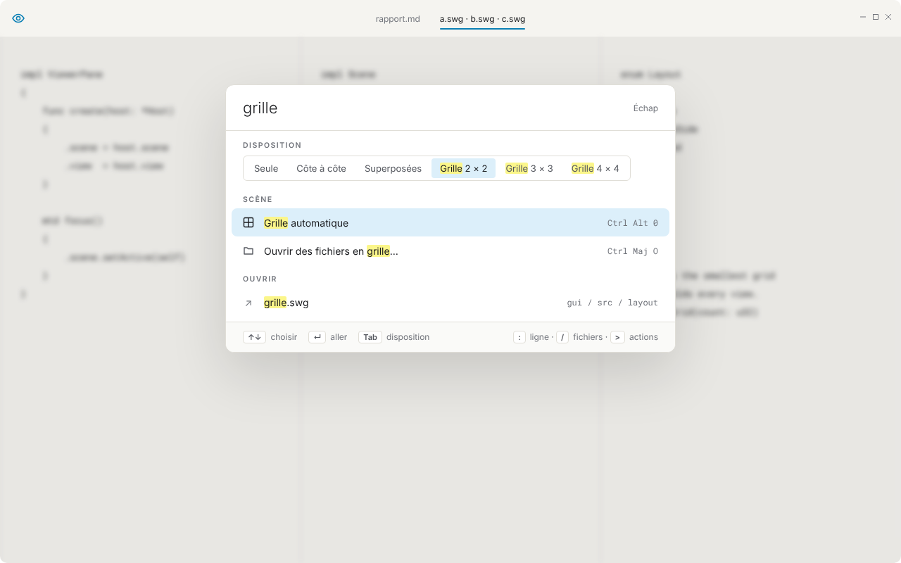
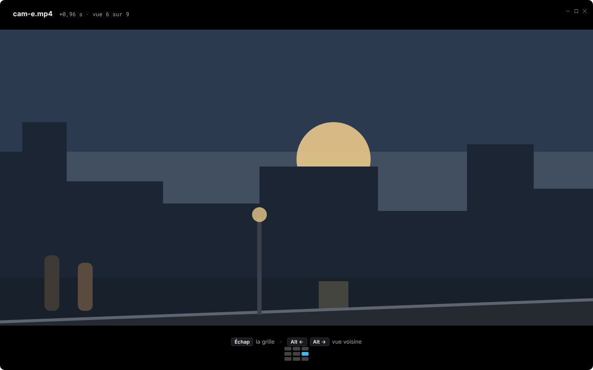
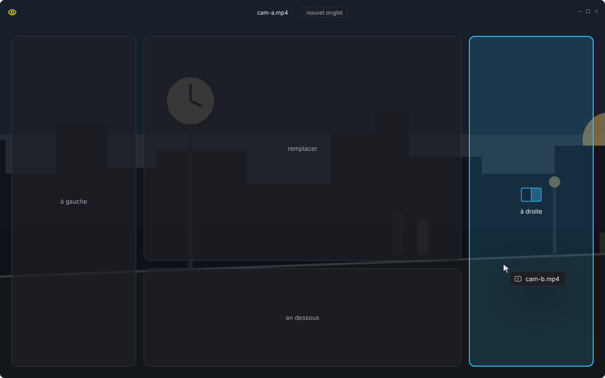
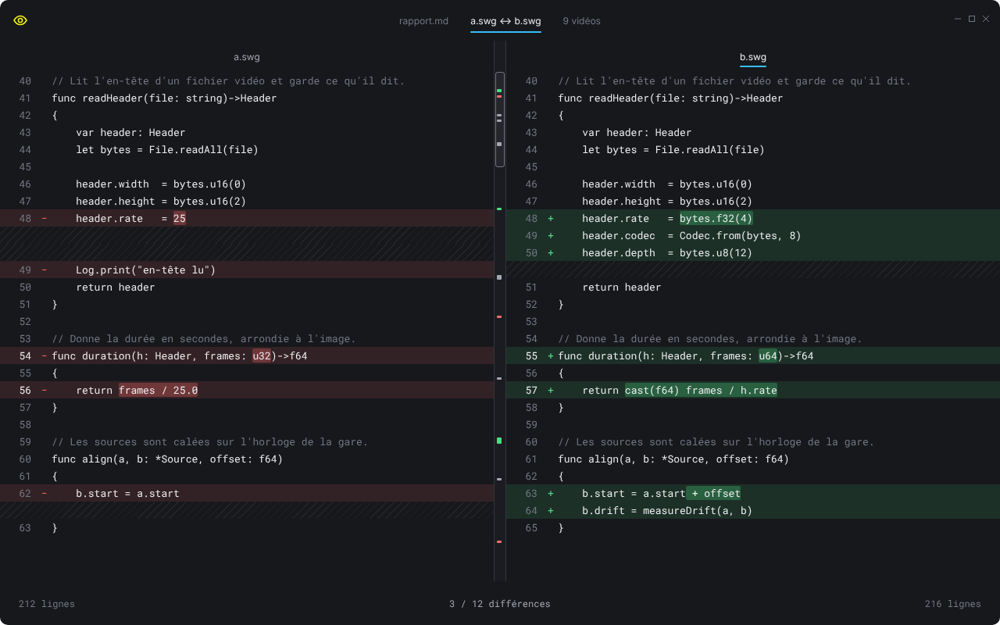
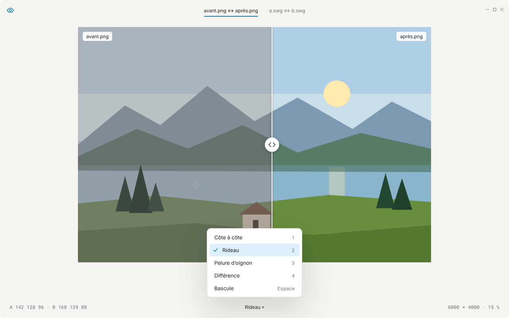
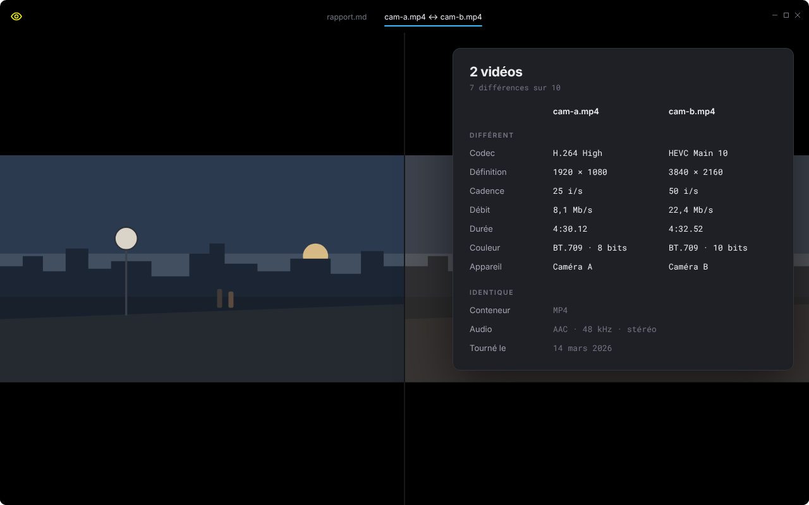
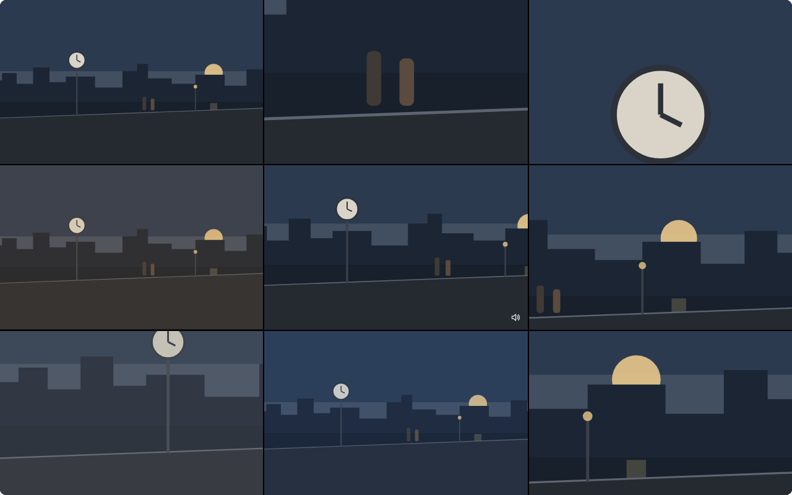
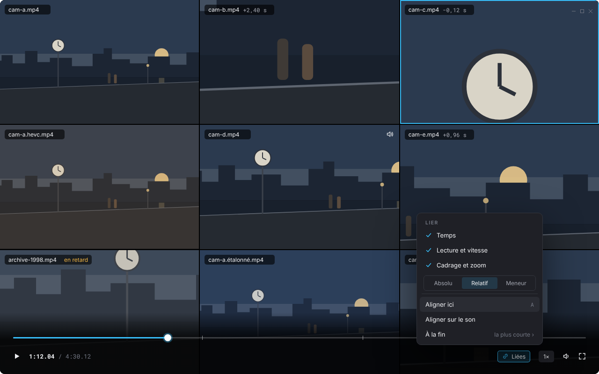

# Multiview — several files in Swag Scope

This folder is the design of Swag Scope holding more than one file: scenes kept in tabs, views
side by side or in a grid, comparison of two documents, and media played together under explicit
synchronization rules. It follows the [Silence charter](../silence/README.md) and adds no new
chrome to a window that shows one file. The pictures in [imgs/](imgs/) are mockups drawn outside
the toolkit, with the charter's tokens and the toolkit's own Inter and Roboto Mono; the text below
states the rules they follow. Where a picture and a rule disagree, the rule wins, and where this
folder and the charter disagree, the charter wins.

The interface strings in the pictures are French. English reference strings follow the charter's
[Wording of commands](../silence/README.md#wording-of-commands) and are given in the text.

[design.multiview.md](design.multiview.md) lists what remains before the code matches this design.

## Principles

1. **One file looks exactly as today.** No tab row, no separator, no added glyph. Everything below
   appears only once a second file is open.
2. **Nothing permanent but the work.** Exactly three things are added, each only while it serves:
   the tab row from the second scene on, the difference band while comparing, and the link chip
   in the transport of linked media.
3. **The lens holds every command; the basic tasks have direct routes.** Opening beside, comparing,
   choosing a layout and linking views are lens entries. Dropping a file, selecting several files
   in the explorer, `Ctrl Tab`, and the visible facts that open their operation (the comparison
   mode at the foot, the link chip) reach the same commands without a name or a shortcut.
4. **One view is active.** The lens, the sheet, search, the outline and the keys act on it, as they
   act on the window today.

## Model

| Term | Meaning |
| --- | --- |
| Document | One open file, its viewer and its reading state (position, zoom, playback, history) |
| View | A place on screen that shows one document |
| Scene | A layout of views and the links between them; the content of one tab |
| Window | The strip, the lens, the sheet, search, and the list of scenes |

A tab holds a scene, not a file. A lone file is a scene of one view; two compared texts are one
scene, named `a.swg ↔ b.swg`; nine videos are one scene, named `9 vidéos` (English reference:
"9 Videos"). Tabs stay few and readable even with sixteen views, and there is never a second row
of tabs inside a scene.

## Scenes in tabs

- With one scene, the strip shows the document's name, centred, 12 px, faint, as the charter's
  window chrome says.
- From the second scene on, the same centred place holds the scene names, 28 px apart. The active
  one takes the text ink and the Arc tab underline (2 px), which slides to a newly chosen tab in
  180 ms; the others stay faint. There is no tab frame, ground or separator.
- A scene's close glyph appears only under the pointer; a middle click also closes it. `Ctrl W`
  closes the active view, and the scene with its last view.
- When the names do not fit, the row fades out toward its ends; there is no chevron or overflow
  menu. Every scene stays reachable from `Ctrl Tab` and from the lens.
- `Ctrl Tab` opens the scene switcher, a floating surface (corner 12, floating shadow) over the
  blurred work, like the lens: a section label with the count, one row per scene in most recent
  order with a 64 × 40 thumbnail, the name and one faint line of what it holds. The chosen row
  is on the Arc selection ground. Holding `Ctrl`, `Tab` and `Ctrl Shift Tab` move; releasing
  opens. The footer teaches the keys.
- An inactive scene suspends its views: decoders and workers are released, positions are kept,
  and the scene resumes where it was. Reopening Scope restores its scenes, layouts and links.

## Layouts

- The layouts are Single, Side by Side, Stacked, Grid 2 × 2, Grid 3 × 3, Grid 4 × 4 and Auto,
  which picks the smallest grid that holds the scene's documents.
- They are one exclusive choice: a segmented control in the lens under a Disposition (Layout)
  section label, as the charter asks of exclusive choices. Auto and Open Files in a Grid… are
  rows beside it.
- Two views are separated by a 1 px hairline in the Line token; it can be dragged, and a double
  click recentres it. Grid cells are equal and are not resized.
- **Which view is active.** In documents, each view shows its file name centred above it, 12 px:
  the active one in the text ink with the Arc underline, the other in the soft ink. In media, the
  active cell is ringed by a 2 px Arc outline painted above the picture whenever the transport is
  shown; while media plays without chrome, nothing marks it.
- **Maximize View** (`F`, or a double click on a cell) gives the scene to the active view; the
  others keep running unseen. A 3 × 3 map at the foot shows where it sits in the grid, and a hint
  line teaches `Esc` (back to the grid) and `Alt ←` `Alt →` (the next view) before it fades.

- `Alt` with an arrow moves the active view; `Ctrl Alt` with an arrow moves the document to the
  neighbouring view.

## Opening several files

| Route | Result |
| --- | --- |
| Open… (`Ctrl O`), or opening from the explorer | A new scene, in a new tab (the default) |
| Dropping a file on the window | Five drop targets appear for the length of the drag |
| Lens: Open Beside… | A view to the right of the active one, in the same scene |
| Lens: Compare With… | A view beside the active one, in comparison mode. Inside a scene that already has several views, the comparison opens in a new tab. |
| Explorer: several files selected, then `↵` | One scene holding them, in the Auto layout |
| Explorer: several files selected, then Compare | The same scene, compared and linked |
| Command line: `swagscope a b` | One scene side by side; `--grid` opens a grid |

While a file is dragged over the window, the work dims and five targets appear: left, right and
below the active view, the view itself (replace), and a "nouvel onglet" (New Tab) target in the
strip. Targets are surfaces with a hairline ring; the one under the pointer takes the Arc
selection ground and a 2 px Arc ring. They leave as the file is dropped or the drag leaves.

## Comparison

**Compare** (`Ctrl D`) turns the comparison of the scene's views on and off; its form follows
the documents. Leaving it keeps the views side by side.

### Text and code

- Two aligned columns. A line missing on one side leaves a faintly hatched gap, so both columns
  keep the same rows.
- **Removed** uses Critical ink on a 12 % ground. **Added** uses Live ink on a 12 % ground.
  Changed characters inside a line take the same ink at 30 %. A `−` or `+` in the gutter carries
  the change without colour.
- The 14 px **difference band** replaces the hairline between the columns: one mark per change
  over the whole file, the visible range framed, a click jumps to a change. It is the only part
  added.
- Scrolling is linked through the alignment. Each column keeps its file name above it.
- The foot reads the line counts in faint mono at either side and `3 / 12 différences` (3 / 12
  Differences) at the centre. Next Difference and Previous Difference (`F7`, `Shift F7`) step
  through them. Identical files read `Identiques` (Identical) and show no tint.
- Ignore Whitespace, Ignore Case, Ignore Line Endings, Unified View and Swap Sides are lens
  entries.
- Any viewer that can give its text takes part: code, text, Markdown source, and later the text
  of a document. Hexadecimal and structured binary comparison use the same band and keys with
  their own alignment.

### Images

- Side by Side links zoom and pan. The other modes overlay both images in one view: **Curtain**
  (a line with a round handle, dragged or placed by a click), **Onion Skin** (the opacity follows
  `Alt` and the wheel), **Difference** (|a − b|, amplified; what does not change stays black) and
  **Flip** (`Space` alternates the two, and the shown name passes briefly at the top).
- The mode is one word at the centre of the foot. As a visible fact, it opens the menu of modes
  (charter law 3); the zoom reading at the right opens the zoom commands. Modes are also numbered
  `1`–`4` and listed in the lens.
- The pixel probe reads both images at the same point, in mono at the left of the foot:
  `A 142 128 96 · B 168 139 88`.
- Each image keeps its name in a small chip at its top corner. Images of different sizes align
  by fit or pixel for pixel.

### Video and sound

Two videos compare with the image modes (Curtain and Difference matter most for encodes); more
are a grid (below). Stacked sound views share one time axis. Only one view is audible at a time:
the active one, unless another is pinned solo.

### The sheet in columns

`I` on a compared scene opens a wider sheet (540) at the right, inset 24: the title (21/800) and
a mono identity line (`7 différences sur 10`), the file names as column heads, then two sections.
**Different** lists the facts that differ, both values in the text ink and mono. **Identical**
lists the others once, in the faint ink. For a comparator, this is often the first thing read.

## Media played together

While a grid plays, the window shows only its pictures, edge to edge, 2 px apart on black, as the
video viewer shows one. The audible view carries a small sound glyph. Nothing else is drawn.

When the pointer moves or playback pauses:

- Each cell shows its name in a small chip at its top left, followed in relative mode by its
  offset in mono (`+2,40 s`). A view that cannot keep pace adds `en retard` (Behind) in the
  Caution ink; the scene does not drift for it.
- The active cell is ringed in Arc.
- **One transport for the scene**, never one per cell: the video viewer's bottom veil, with the
  timeline (Arc progress, white knob, chapter ticks), time in mono and its chips. When views are
  linked it drives them all; otherwise it drives the active view.
- A **Liées** (Linked) chip, Arc when on, is the only visible trace of synchronization. It opens
  the link menu; `L` toggles it.

### Links

A scene links its views axis by axis:

| Axis | What is linked |
| --- | --- |
| Time | The playback position |
| Playback | Play, pause, rate, frame steps |
| Framing | Zoom and pan, in normalized coordinates |
| Scroll | The aligned line in text, the page in paged documents |

Time follows one of three modes, a segmented choice in the link menu:

- **Absolute**: every view shows the same instant.
- **Relative**: Align Here (`A`) takes each view's current position as its zero; the scene then
  keeps those offsets. Align on Sound computes them from the audio.
- **Leader**: one view leads, the active one by default; the others follow it.

Rules:

- Different frame rates synchronize on time, not on frame numbers. A frame step follows the
  leader's rate; each other view shows its last frame at or before that time.
- Different durations follow At End: stop with the shortest, let each stop alone, or loop on the
  leader.
- A follower seeks when it drifts by more than half a frame and otherwise corrects its pace.
- Defaults: a scene opened by Compare or as a media grid links Time, Playback and Framing; a scene
  opened beside starts unlinked.
- Decoding is budgeted: each video decodes at its cell's size, hardware decoders are capped, and
  one sound stream plays. Maximizing a view restores its full resolution.

## Keys

The keys below are proposals and must be checked against the existing shortcut table before
they are adopted.

| Key | Action |
| --- | --- |
| `Ctrl Tab`, `Ctrl Shift Tab` | Next and previous scene, through the switcher |
| `Ctrl W` | Close the active view; the scene with its last view |
| `Ctrl \` | Side by Side |
| `Ctrl Alt 2`, `3`, `4`, `0` | Grid 2 × 2, 3 × 3, 4 × 4, Auto |
| `Alt ←↑→↓` | Activate the neighbouring view |
| `Ctrl Alt ←↑→↓` | Move the document to the neighbouring view |
| `F`, `Esc` | Maximize View, back to the grid |
| `Ctrl D` | Compare |
| `F7`, `Shift F7` | Next and previous difference |
| `1`–`4`, `Space` | Image comparison modes, Flip |
| `L` | Link Views |
| `A` | Align Here |
