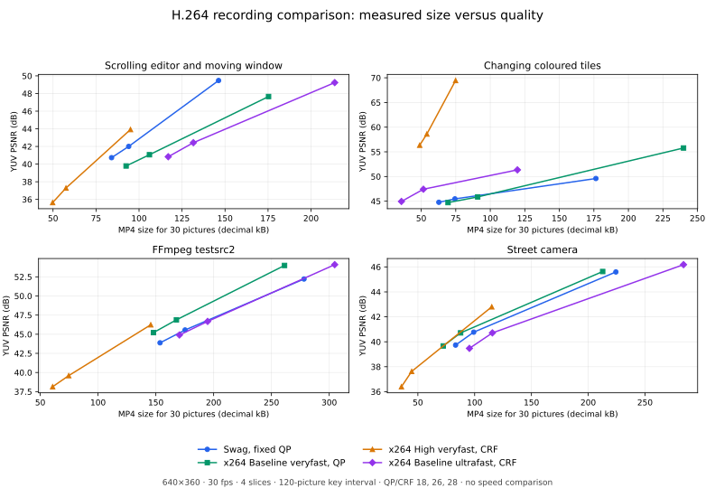

# H.264 chroma DC reduction, 2026-11-16

The encoder now reduces chroma DC levels when their contribution disappears in the decoder's
integer rounding. It applies this only to a plane without AC coefficients and preserves all four
decoded block corrections. Reconstruction and coded-block flags use the reduced levels.
This improves compression at exactly the same decoded quality; it does not make lossy encoding
lossless or establish a general percentage gain.

## Before and after

Four 640x360 clips, 30 pictures each, fixed QP 18/26/28, four slices, key interval 120, 30 fps,
three workers, Release target. The baseline is `8eaff2147a`; only the encoder source changes in
the external library snapshot between measurements. Inputs and compiler executable stay fixed.
The source and decoded hashes match at all 12 points, and Swag Reader and FFmpeg produce identical
planar output for each Swag file. Measurements and hashes are in [measurements.json](measurements.json).

At QP 18, full MP4 sizes are:

| Scene | Before, bytes | After, bytes | Reduction |
| --- | ---: | ---: | ---: |
| Scrolling editor and moving window | 146,253 | 146,241 | 0.0082% |
| Changing coloured tiles | 178,546 | 176,465 | 1.1655% |
| FFmpeg testsrc2 | 278,228 | 278,176 | 0.0187% |
| Street camera | 224,380 | 224,348 | 0.0143% |

The packet payload shrinks by the same number of bytes. QP 26 and 28 are unchanged on all four
clips: their chroma scale reaches the optimization's early-out threshold. The useful gain here
is concentrated in flat coloured regions at finer quantization.

Capture's shipped Balanced setting uses QP 22 and Compact uses QP 28. The encoder gives key
pictures a three-step finer QP, so the DC optimization can also affect Balanced key pictures.
The QP 18 measurements above are a finer experimental setting, not Capture's default preset.

A supplemental run on 2026-11-17 checks QP 22 against the original encoder with the same inputs
and compiler. All four decoded hashes and metrics match. The practical size gain for this preset
is much smaller than the QP 18 tile result:

| QP 22 scene | Before, bytes | After, bytes | Saved bytes |
| --- | ---: | ---: | ---: |
| Editor | 120,592 | 120,590 | 2 |
| Tiles | 117,640 | 117,631 | 9 |
| Testsrc2 | 226,738 | 226,738 | 0 |
| Street | 147,859 | 147,850 | 9 |

## Other recording encoders

The [maintained benchmark](../../../workloads/h264/README.md) explains the primary sources and
reproduction commands. It compares a controlled x264 Baseline/veryfast/fixed-QP configuration,
an OBS-style x264 High/veryfast/CRF configuration, and ShareX's x264 Baseline/ultrafast/CRF choices.
Slices, key interval, frame rate and input samples are held constant, rather than reproducing
each recorder's entire pipeline. Hardware encoders used by Bandicam and others could not be
measured on this machine, which has no compatible GPU device.

These are the measured points at the numeric setting 18. QP and CRF are different controls;
the rows show actual rate and quality, not equal-quality comparisons. PSNR is the aggregate
over Y, U and V against the exact NV12 samples given to both encoders.

Swag writes fragmented MP4; FFmpeg's x264 runs write ordinary MP4. Swag's container overhead
is 4,087 bytes per one-second clip here. The JSON retains packet sizes as well, so codec
payload and container overhead can be assessed separately. These short-clip file sizes should
not be extrapolated directly to the overhead of longer recordings.

| Scene | Encoder configuration | MP4 bytes | PSNR, dB | SSIM |
| --- | --- | ---: | ---: | ---: |
| Editor | Swag, QP 18, after | 146,241 | 49.476 | 0.996000 |
| Editor | x264 Baseline veryfast, QP 18 | 175,303 | 47.660 | 0.994681 |
| Editor | x264 High veryfast, CRF 18 | 95,035 | 43.921 | 0.990090 |
| Editor | x264 Baseline ultrafast, CRF 18 | 213,760 | 49.238 | 0.996011 |
| Tiles | Swag, QP 18, after | 176,465 | 49.599 | 0.992343 |
| Tiles | x264 Baseline veryfast, QP 18 | 239,908 | 55.780 | 0.997856 |
| Tiles | x264 High veryfast, CRF 18 | 74,891 | 69.455 | 0.999894 |
| Tiles | x264 Baseline ultrafast, CRF 18 | 119,642 | 51.347 | 0.998631 |
| Testsrc2 | Swag, QP 18, after | 278,176 | 52.216 | 0.998349 |
| Testsrc2 | x264 Baseline veryfast, QP 18 | 261,308 | 53.986 | 0.999234 |
| Testsrc2 | x264 High veryfast, CRF 18 | 145,595 | 46.234 | 0.997760 |
| Testsrc2 | x264 Baseline ultrafast, CRF 18 | 304,733 | 54.093 | 0.999204 |
| Street | Swag, QP 18, after | 224,348 | 45.597 | 0.987601 |
| Street | x264 Baseline veryfast, QP 18 | 212,732 | 45.632 | 0.987616 |
| Street | x264 High veryfast, CRF 18 | 115,075 | 42.802 | 0.982618 |
| Street | x264 Baseline ultrafast, CRF 18 | 283,914 | 46.183 | 0.988414 |

All three settings per scene and configuration are retained in the JSON. Swag remains behind
x264 High on the tile sequence, where x264 is both smaller and more accurate, and behind the
controlled Baseline configuration on testsrc2. The editor favours Swag relative to the controlled
Baseline point. This small corpus does not support an overall ranking across recording tools.
Future work should examine chroma quantization and mode decisions on flat regions, with matched
quality comparisons and isolated encode-time measurements before accepting more expensive searches.

The lines connect measured points to help read the tradeoff; they are not predictions between
settings. Larger PSNR at a given size is better. Scene-dependent quality and size scales differ.

Metrics compare two raw planar sequences in frame order to prevent colour metadata from
silently converting reference samples. The metric self-check uses a lossless BT.709-tagged
stream with a five-second timestamp offset: infinite PSNR and SSIM 1 are required. A direct
sum of squared luma errors independently confirms the tile result within 0.00001 dB.
Metrics were recomputed from retained files after correcting the initial colour-negotiation
filter. Concurrent compilation makes timing results unsuitable for comparison; this run uses
`--quality-only`, and timing fields are deliberately null.

## Validation

- H.264 functional encoder family in devmode: 47 tests passed, including the new chroma DC
  regression across chroma QPs 0 through 39 and signed coefficient patterns. It checks the
  actual inverse kernel, decoded samples, padding and nonincreasing coefficient magnitudes.
- Swag Capture Release application built in the main checkout at `4d88d1711c` with this encoder
  change. Subsequent upstream commits integrated before delivery concern Scope and GUI test-host
  shutdown; they do not modify the encoder or Capture's recording path.
- Existing X11 dynamic 4K capture integration: one test passed, recording and reading 60
  3840x2160 pictures with audio at QP 18 and four slices. Final-frame luma PSNR is 57.978843 dB;
  the retained MP4 is 3,608,543 bytes. FFmpeg decodes the whole file without errors and ffprobe
  counts all 60 pictures. This proves correctness, not sustained real-time 4K60 throughput.
- Two pre-existing `compiler.core.111` warnings in `thread.linux.swg` occur during dependency
  compilation; their false-positive pattern is already documented in the repository.

The workload generator records the explicit font hash and optional camera hash. The street
sequence uses OpenCV's public `samples/data/vtest.avi`, starting at two seconds, resized to
640x360. No media, generated build output or external encoder library is added to production.
