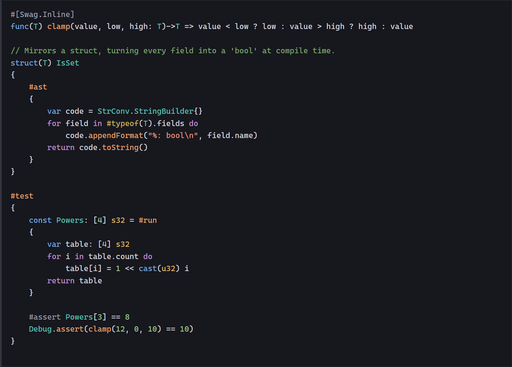

# Swag

Syntax highlighting and a dark theme for Swag in Visual Studio Code.

# Screenshot

# Features

 - Syntax highlighting from a TextMate grammar checked against the compiler token catalog
 - Theme 'Swag Dark', which uses the same token colors as the generated documentation,
   so code reads the same in the editor and on the language reference

The extension is declarative: it contributes a language, a grammar, and a theme, and runs
no code.

## Validation

Run `npm ci`, then `npm test` for the TextMate grammar. `tools/vsix.bat` runs both and
packages the extension; the package is a build output and is not kept in the repository.
